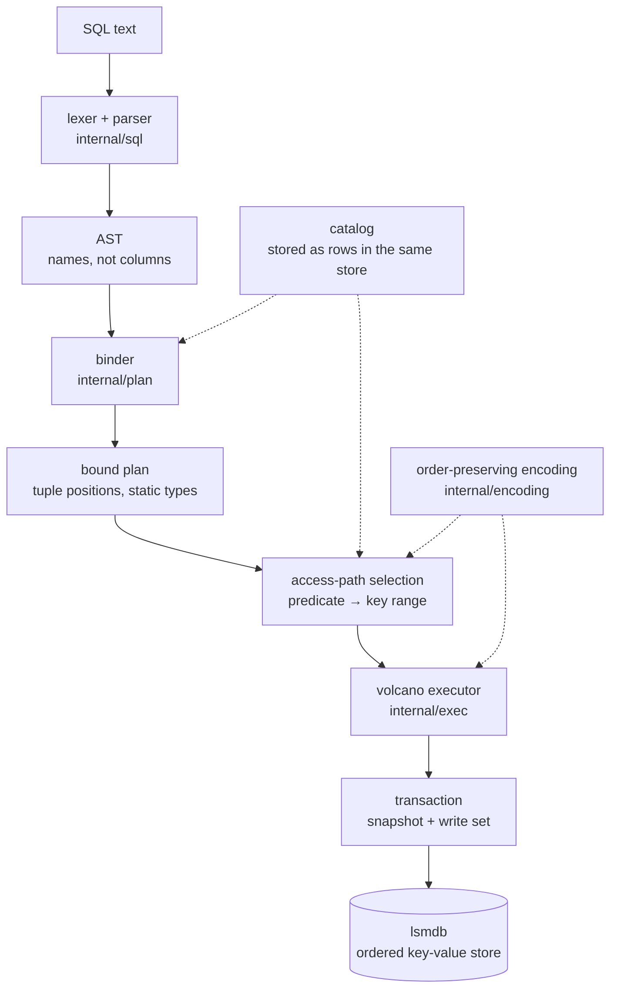

# quarry

A relational **SQL database** built on top of [lsmdb](https://github.com/dhananjaypesu/lsmdb), the
log-structured merge-tree storage engine in the repository next door.

Parser, binder, planner, access-path selection, transactional execution — written from scratch in
Go with **zero external dependencies**, standard library only.


```sql
quarry> SELECT city, COUNT(*) n, AVG(age) FROM users GROUP BY city ORDER BY n DESC;
city    n  AVG(age)
------  -  --------
london  2  38.5
nyc     1  45
austin  1  72
(3 rows)

quarry> EXPLAIN SELECT u.name, o.total FROM users u JOIN orders o ON o.user_id = u.id
     ->   WHERE u.city = 'london' AND o.total > 30;
Project name, total
  -> HashJoin on id = user_id
    -> Scan users AS u [index users_city range: city = london]
    -> Scan orders AS o [full scan] filter=(total > 30)
```

---

## Why build this

A storage engine answers one question: *what is the value at this key?* A database answers a
different one: *which rows satisfy this sentence?* Everything interesting lives in the gap between
them, and the gap is narrower than it looks — it is spanned by a single idea.

**The storage engine has exactly one ordering: bytewise over keys.** So every access path a query
planner can choose must be expressible as a *range of bytes*. That constraint drives the whole
design:

| Question | Answer |
|---|---|
| How does `WHERE id = 3` avoid reading the table? | Rows are keyed by their encoded primary key, so the predicate becomes a one-key range |
| How does `WHERE age BETWEEN 30 AND 50` work? | Integers are encoded so that byte order *is* numeric order, so the predicate becomes a byte range |
| What is a secondary index? | A second copy of the rows, keyed by the indexed columns, whose value is the primary key |
| Why must NULL sort first? | It is given the smallest type tag, so `ORDER BY` and range bounds get NULL placement for free |
| Why can't `WHERE a = 1 OR a = 5` use the key? | A disjunction is two ranges, and this planner emits one |

Get the encoding wrong and an index scan silently skips rows — the kind of bug that only appears on
the rows you did not test. That is why the first test in the suite is an exhaustive check that
byte order matches SQL order over a randomized sample of every type.

## Architecture

A statement travels one straight path, and each stage throws away a kind of ambiguity the next
stage would otherwise have to carry:



The binder is where names become positions. After it runs, no operator ever looks a column up by
name while rows are streaming — a column reference is an offset into a tuple. That single change is
most of the difference between an interpreter that walks strings and one that scans a million rows
in 40 ms.

```
internal/sql/        lexer, AST, recursive-descent parser with precedence climbing
internal/types/      the four column types, one boxed Value, three-valued comparison
internal/encoding/   order-preserving key encoding; length-prefixed row encoding
internal/catalog/    schemas, stored as ordinary rows so that DDL is transactional
internal/expr/       bound expressions: positions, static types, SQL NULL logic
internal/plan/       binder, plan nodes, predicate pushdown, access-path selection
internal/exec/       volcano operators, index maintenance, DML and DDL execution
internal/txn/        snapshot + write set, with an overlay iterator for read-your-writes
cmd/quarry/          interactive SQL shell
cmd/quarrybench/     benchmark harness
```

### The keyspace

Everything the database knows lives in one ordered keyspace, split by a leading tag byte:

```
0x01 | "table" 0x00 <name> 0x00                     -> JSON schema
0x02 | <table id: 4B> | <encoded primary key>       -> encoded non-key columns
0x03 | <index id: 4B> | <encoded cols> [| <pk>]     -> encoded primary key
```

Two consequences fall out of this and are worth stating, because they are the reasons to build it
this way:

**DDL is transactional and free.** A schema is a row. `CREATE TABLE` inside a transaction commits
in the same atomic batch as the rows that depend on it, so a crash can never leave data belonging
to a table that does not exist. Rolling back a `CREATE TABLE` requires no undo log — nothing was
written.

**A unique index is a point read.** For a unique index the primary key is left *out* of the entry
key, so two rows with the same indexed values would collide on the same key, and enforcing
uniqueness is a single `Get`. The trick is only sound when no indexed column is NULL — SQL holds
that NULLs are not equal to each other — so entries containing a NULL keep the primary key suffix
and skip the check. That is how the engine admits many NULLs into a unique index without a special
case anywhere else.

### Access-path selection

The planner splits the `WHERE` clause into conjuncts and, for each candidate path, matches the
path's key columns left to right: equalities extend the key prefix, and the first column without an
equality may contribute range bounds. The path with the most matched columns wins, with a
deliberate tie-break — **an index must beat the primary key outright**, because reaching a row
through an index costs a second lookup, so a tie is not a win.

```
SELECT * FROM users WHERE id = 3            ->  primary key lookup: id = 3
SELECT * FROM users WHERE id > 2 AND id <= 4->  primary key range: id > 2, id <= 4
SELECT * FROM users WHERE city = 'london'   ->  index users_city range: city = london
SELECT * FROM users WHERE name = 'ada'      ->  full scan
SELECT * FROM users WHERE id = 1 OR id = 3  ->  full scan
```

Predicates are pushed through joins to the scan that can use them, which is what produces the
two-sided plan at the top of this README. The exception is the null-extended side of a `LEFT JOIN`:
a predicate pushed there would delete rows the join is required to preserve, so that side is marked
unpushable.

## What it supports

```sql
CREATE TABLE users (id INT PRIMARY KEY, name TEXT NOT NULL, city TEXT, age INT);
CREATE TABLE events (a INT, b TEXT, PRIMARY KEY (a, b));   -- composite keys
CREATE TABLE log (msg TEXT, level INT);                    -- no key: a hidden row id is added
CREATE INDEX users_city ON users (city);
CREATE UNIQUE INDEX users_name ON users (name);

INSERT INTO users VALUES (1,'ada','london',36), (2,'grace','nyc',45);
UPDATE users SET age = age + 1 WHERE city = 'london';
DELETE FROM users WHERE age IS NULL;

SELECT DISTINCT city FROM users WHERE name LIKE 'a%' AND age BETWEEN 30 AND 50;
SELECT u.name, SUM(o.total) spend FROM users u JOIN orders o ON o.user_id = u.id
  GROUP BY u.name HAVING COUNT(*) > 1 ORDER BY spend DESC LIMIT 10;
SELECT u.name, o.id FROM users u LEFT JOIN orders o ON o.user_id = u.id;

BEGIN; INSERT INTO users VALUES (3,'alan','london',41); ROLLBACK;
EXPLAIN SELECT * FROM users WHERE city = 'london';
SHOW TABLES;  DESCRIBE users;
```

Types are `INT`, `FLOAT`, `TEXT`, `BOOL`. Aggregates are `COUNT`, `SUM`, `AVG`, `MIN`, `MAX`.
Joins are inner, left outer and cross, executed as a hash join when the `ON` clause yields equality
keys and as a nested loop when it does not — `EXPLAIN` says which, because a nested loop over two
large tables is the difference between a query that returns and one that does not.

## Usage

```bash
git clone https://github.com/dhananjaypesu/quarry && cd quarry
go run ./cmd/quarry -db ./mydata
```

```
quarry> CREATE TABLE users (id INT PRIMARY KEY, name TEXT NOT NULL, city TEXT);
quarry> \d          -- list tables
quarry> \s          -- storage engine statistics
quarry> \q
```

As a library:

```go
db, err := quarry.Open("./mydata", quarry.DefaultOptions())
defer db.Close()

db.Exec(`CREATE TABLE users (id INT PRIMARY KEY, name TEXT NOT NULL)`)
db.Exec(`INSERT INTO users VALUES (1, 'ada'), (2, 'grace')`)

res, err := db.Query(`SELECT name FROM users WHERE id = 1`)
fmt.Println(res.Columns, res.Rows[0][0])   // [name] ada

// A statement outside BEGIN runs in an implicit transaction that commits on
// success and rolls back on failure.
db.Exec(`BEGIN; UPDATE users SET name = 'Ada' WHERE id = 1; COMMIT;`)
```

## Benchmarks

Apple M2 (8 cores), macOS 26.5, Go 1.26. 200,000 rows of `(INT, TEXT, FLOAT, TEXT)`, loaded 500 per
transaction. Every figure below goes through the full path — parse, bind, plan, execute — with no
prepared-statement caching anywhere. Reproduce with `make bench`.

| Workload | Throughput | Per operation |
|---|---:|---:|
| Load (batched 500/txn) | 105,924 rows/s | 9.4 µs |
| Build secondary index over 200k rows | 1,060,638 rows/s | 942 ns |
| Point lookup by primary key | 119,857 queries/s | 8.3 µs |
| Full scan with aggregate | 5,247,244 rows/s | 190 ns |
| Index scan (`WHERE tag = ?`, ~40k rows) | 628,437 rows/s | 1.6 µs |
| `GROUP BY` over 200k rows | 3,351,071 rows/s | 298 ns |

Storage after the run: 4 sstables over 7 levels, 19.6 MB of user data, 47.6 MB written,
**2.43× write amplification**.

### A point lookup costs 8 µs, and almost none of it is the lookup

A full scan reads a row in 190 ns. A point lookup — which reads exactly one row — takes 8.3 µs.
The difference is not storage; the storage engine underneath serves point reads in about 2 µs.
It is that a scan pays the front end **once** and amortizes it over 200,000 rows, while a lookup
pays it for a single row: lexing, parsing, binding against the catalog, choosing an access path,
building an operator tree, and opening an iterator.

That is the honest cost of not caching prepared statements, and it is the clearest argument for
why real databases do. The plan for `SELECT amount FROM bench WHERE id = ?` is identical every
time; only the constant changes. Parameterizing the plan and caching it by statement text is the
single highest-value thing missing from this engine, and the benchmark is what makes that visible
rather than a matter of opinion.

## Testing

```bash
make race     # full suite under the race detector
make cover
```

**26 tests, 72% statement coverage**, all under `-race`, with the randomized model test repeated
`-count=5` in CI.

The test that carries the most weight is **`TestRandomizedAgainstModel`**. A query engine has too
many interacting parts — encoding, catalog, planner, executor, index maintenance — for hand-picked
cases to cover the space, and its failures are quiet: one wrong row among thousands of right ones.
So it runs **3,000 random statements** (inserts, updates, point deletes, range deletes, bulk
updates) against a plain Go map, and after each batch checks three different questions three
different ways — a full scan, an index scan, and a primary-key range scan — requiring exact
agreement every time. An index entry orphaned by a delete, a range bound off by one key, or an
update that writes to the old key all surface here and nowhere else.

Others worth naming:

- **`TestKeyEncodingIsOrderPreserving`** — every pair from a randomized sample of each type,
  asserting that `bytes.Compare` of the encodings agrees with SQL comparison. This is the property
  every range scan in the engine rests on.
- **`TestNullSemantics`** — that a row with `city = NULL` appears in neither `city = 'london'` nor
  `city != 'london'`, because UNKNOWN is not FALSE, and that `COUNT(*)` and `COUNT(city)` differ.
- **`TestIndexesStayConsistentWithRows`** — the same question asked through an index and through a
  full scan must agree after inserts, updates and deletes.
- **`TestUniqueIndex`** — duplicates rejected, but many NULLs admitted.
- **`TestTransactions`** — read-your-own-writes inside a transaction, rollback discarding them, and
  a rolled-back `CREATE TABLE` leaving no table behind.
- **`TestUpdateAndDelete`** — an `UPDATE` that changes a primary key must move the row, not
  duplicate it.
- **`TestDropTableReclaimsTheKeyspace`** — a new table must not inherit a dropped one's rows.

## Design notes and limitations

Stated plainly, since they are the honest boundary of the project:

- **No prepared statements or plan cache.** Every statement is re-parsed and re-planned, which the
  benchmark above quantifies at roughly 6 µs per query. This is the first thing I would fix.
- **No statistics, so no cost model.** Access-path selection counts matched key columns rather than
  estimating selectivity; the hash join always builds on the right input because there is no basis
  for choosing the smaller one.
- **Sorts, hash joins and aggregations are in memory.** Nothing spills to disk, so a query whose
  working set exceeds memory fails rather than degrading. Failing loudly beats a silent truncation,
  but external merge sort is the real answer.
- **A disjunction cannot use an index.** `a = 1 OR a = 5` is two ranges; the planner emits one and
  falls back to a full scan.
- **No subqueries, `UNION`, or `ALTER TABLE`.** The encoding is designed for schema evolution —
  rows address columns by id, so adding a column would need no rewrite of existing rows — but the
  statement to use it is not implemented.
- **One writer.** Transactions take a snapshot and hold their writes until commit, so readers never
  block; concurrent writers would need conflict detection at commit, which is not there.
- **`DELETE` and `UPDATE` buffer the rows they touch** before writing, because they read through
  the same transaction they write into. Correct, but memory-bound on very large mutations.

## Related

- **[lsmdb](https://github.com/dhananjaypesu/lsmdb)** — the storage engine underneath: skip-list
  memtable, write-ahead log, bloom-filtered SSTables, leveled compaction, MVCC snapshots.
- **[raftkv](https://github.com/dhananjaypesu/raftkv)** — Raft consensus and replication, the other
  direction this layer can be pointed.

## References

- Graefe, [*Volcano — An Extensible and Parallel Query Evaluation System*](https://cs-people.bu.edu/mathan/reading-groups/papers-classics/volcano.pdf) (1994)
- Selinger et al., *Access Path Selection in a Relational Database Management System* (1979)
- [CockroachDB's encoding documentation](https://github.com/cockroachdb/cockroach/blob/master/docs/tech-notes/encoding.md), for the order-preserving key format
- Pratt, *Top Down Operator Precedence* (1973)

## License

MIT
